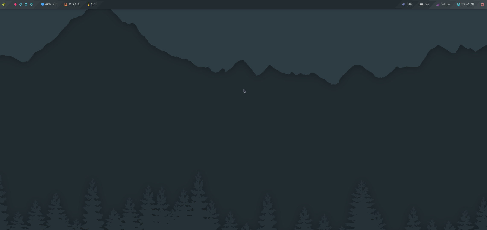
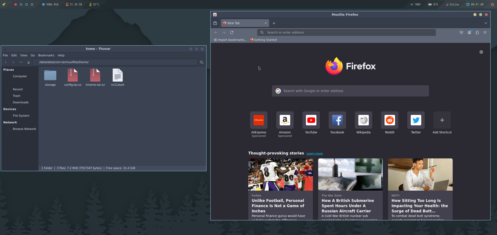
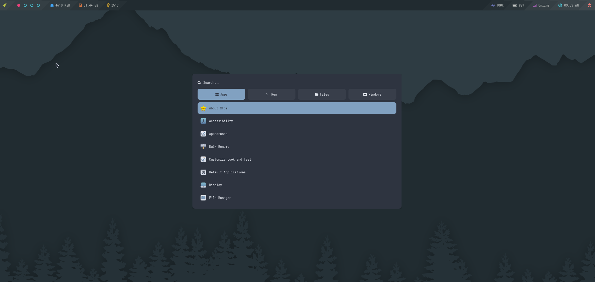
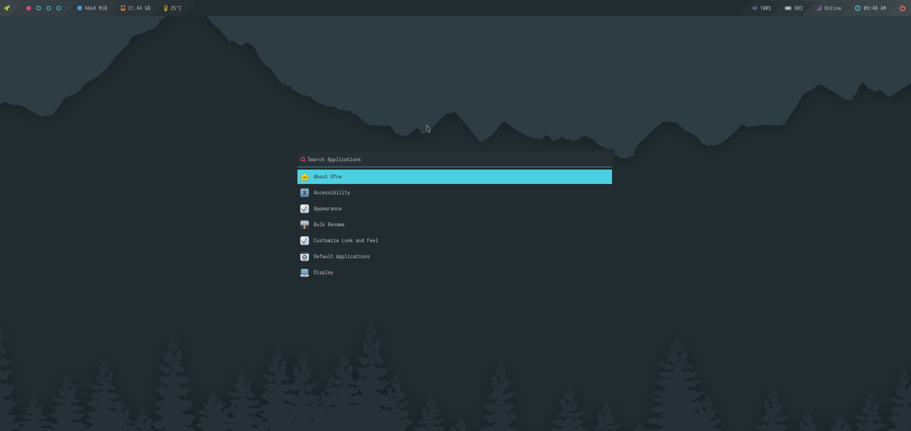
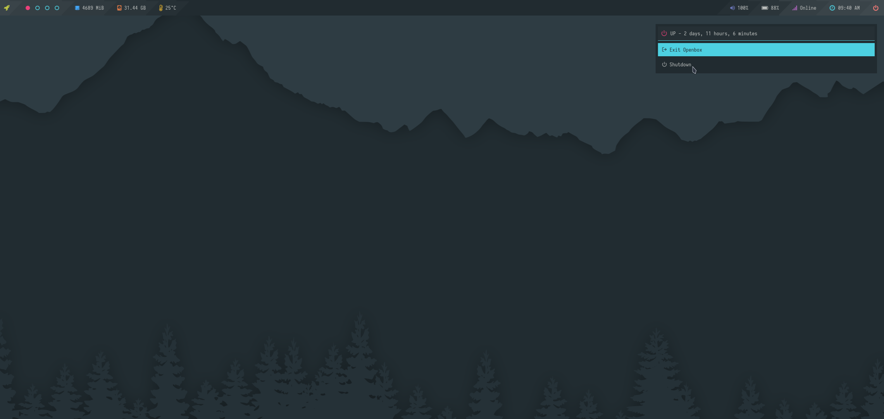

# Termux-dk

> [!WARNING]
> It works but is in the process of change 

# Desktop Styles 

### Keybord shortcuts:- [Here](https://github.com/sabamdarif/termux-desktop/blob/main/see-more.md#openbox-keybindings-cheat-sheet)
>Inspired from [adi1090x's termux-desktop](https://github.com/adi1090x/termux-desktop)


<details>
<summary><b style ="font-size: small">Style Details: </summary>
Theme Used: 
<br>

- GTK Theme:- [Nordic-darker](https://www.gnome-look.org/p/1267246)
- Openbox Theme:- [Nord-Openbox](https://gitlab.com/the-zero885/nord-openbox-theme)
- Kvantum:- [Nord-Kvantum](https://store.kde.org/p/1533594)

Icon Used:
<br>

- Icons:- [Nordzy](https://store.kde.org/p/1686927)
- Cursor Theme:- [Nordic-cursors](https://www.gnome-look.org/p/1662218/)

</b>
</details>
<br>

<center></center>

<details style ="font-size: larger">
<summary><b style ="font-size: larger">Screenshots: </b></summary>

| Apps | Dashboard |
|:--:|:--:|
|  |  |
| **Launcher** | **Powermenu**  |
|  |  

</details>

<br>

# Install 

```bash
pkg update && pkg install -y git
git clone https://github.com/VictorH028/termux-dk.git && cd termux-dk
make
```

> [!NOTE]
> Install the [Termux:X11](https://github.com/termux/termux-x11) app and the
> [Termux:API](https://f-droid.org/packages/com.termux.api/) app for the desktop
> and the battery module to work. Run `termux-setup-storage` once if you want the
> filesystem module to read `/storage/emulated`.

# Start 

```bash
export DISPLAY=:0
termux-x11 :0 -xstartup "dbus-launch --exit-with-session openbox-session" &
```

Then open the Termux:X11 app.

You can also use VNC instead:

```bash
vncserver :1
```

# Warnings

- **Resolution / DPI:** the default is `2400x1080` at `dpi=160`, matching a
  20:9 phone screen. If the VNC viewer still shows `1600x900`, close the viewer
  and restart the server with `vncserver -kill :1 && vncserver :1`.
- If text looks too small or too large, change `dpi` in `~/.vnc/config`, the
  `Xft.dpi` value in `~/.config/openbox/autostart` and `dpi` in
  `~/.config/polybar/config.ini` (keep all three values equal).
- With Termux:X11 the resolution is controlled by the Termux:X11 app settings,
  not by these files.
- **CPU and temperature modules do not work on Android without root**, because
  `/proc/stat` and `/sys/class/thermal` are restricted. The bar uses an
  `uptime` module instead.
- **Battery:** requires the Termux:API app. The scripts use a timeout so the
  bar does not freeze when the API is unavailable.
- **Polybar tray** was removed because it is deprecated in Polybar 3.7. Use the
  `internal/tray` module if you need tray icons.
- After changing files from this repo, run `make` again or copy them to
  `$HOME` and restart the session (`openbox --restart`).


> [!NOTE]
> All the configuration that you find here is a light version for termux without using proot of this project
    > [SEE](https://github.com/sabamdarif/termux-desktop/tree/main) 
